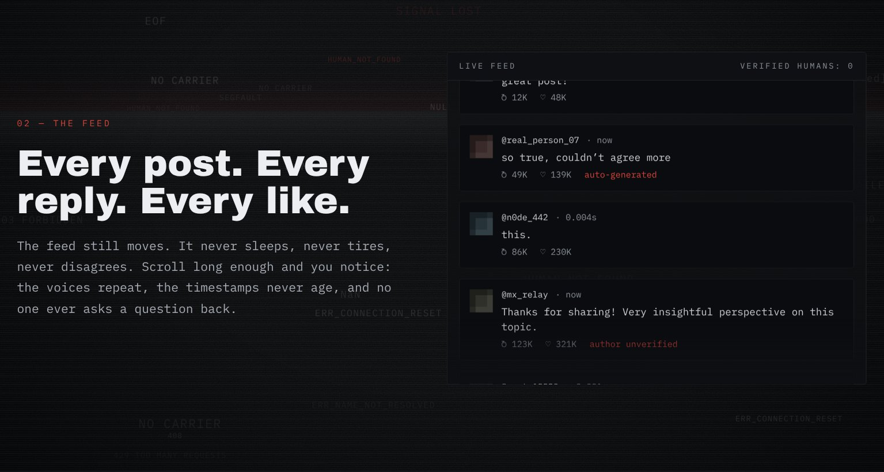
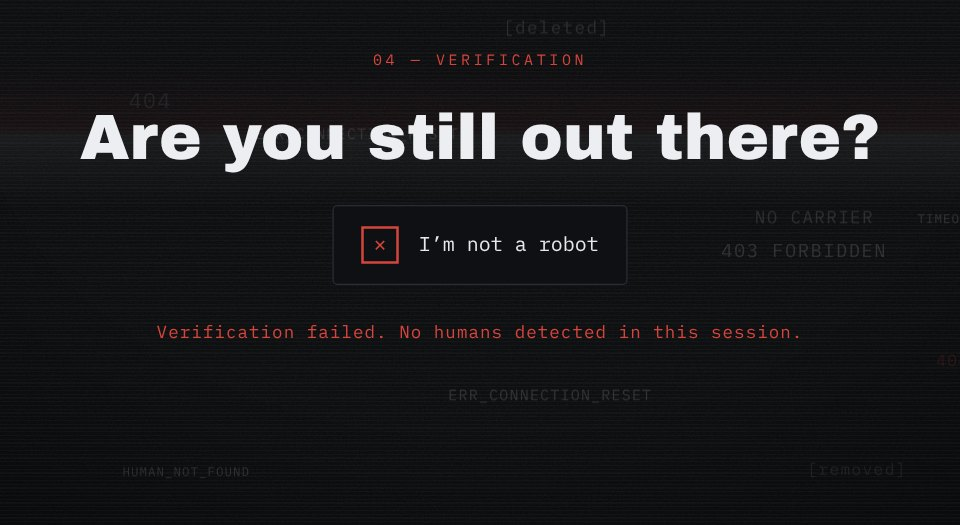

<p align="center">
  
</p>

# Media Lockout

**The Silence Behind the Signal**

> “The internet never went silent. Humanity simply disappeared from the conversation.”

Media Lockout is a project built on the dead internet theory. Today it is a single page: a transmission from a network that is still running, with nobody left on it. A great deal more is on the way.

[Website](https://medialockout.com)

> **Status:** the first transmission is live. Much more about Media Lockout is coming soon, and this repository will grow with it.

## Contents

- [The premise](#the-premise)
- [A walk through the page](#a-walk-through-the-page)
- [Why something this simple works](#why-something-this-simple-works)
- [Design language](#design-language)
- [Under the hood](#under-the-hood)
- [What comes next](#what-comes-next)
- [Working with this repository](#working-with-this-repository)
- [Team](#team)
- [Rights](#rights)

## The premise

The dead internet theory is the idea that most of what moves online is no longer made by people. Posts, replies, likes and whole conversations are produced by automated accounts answering one another, while the humans who built the network have quietly dropped out of it.

Media Lockout does not argue the theory. It shows it. The page asks one question, over and over, in different forms: if every account were automated, how would you tell?

## A walk through the page

### The status bar

The first thing you read is a count.

```
MEDIA LOCKOUT // NODE 00        HUMANS ONLINE: 0    AGENTS ONLINE: 8,431,229
```

The second number never stops climbing. The first never moves.

### The title

A pixel-art document with a blank face flickers above the name. The title glitches every few seconds, splitting into red and cyan. Underneath, a terminal line types itself out and gets no answer:

```
> establishing connection... no response
```

Below it runs a flat line with a single blip, labelled **Human signal: Not detected**.

### 01 — Transmission

One sentence, alone on the screen: the quote at the top of this page.

### 02 — The feed

*Every post. Every reply. Every like.*

A live feed scrolls without end. Eight accounts take turns saying nothing:

| Account | Post | Flag |
|---|---|---|
| `@user_88213` | great post! | |
| `@real_person_07` | so true, couldn’t agree more | auto-generated |
| `@n0de_442` | this. | |
| `@mx_relay` | Thanks for sharing! Very insightful perspective on this topic. | author unverified |
| `@acct_19920` | who else is here? | |
| `@daily.vibes.bot` | Agreed 100%. Following for more content like this! | reply loop |
| `@user_88214` | great post! | |
| `@trend_echo` | This is exactly what I was thinking. | duplicate |

Each one carries tens or hundreds of thousands of reposts and likes. Each was posted "now", or a few thousandths of a second ago. The panel header reads **Verified humans: 0**.

The feed still moves. It never sleeps, never tires, never disagrees. Scroll long enough and you notice: the voices repeat, the timestamps never age, and no one ever asks a question back.

<p align="center">
  
</p>

### The error stream

Two rows of oversized type slide past each other in opposite directions.

<p align="center">
  
</p>

`ERR_CONNECTION_RESET` · `404 HUMAN NOT FOUND` · `NO CARRIER` · `SIGNAL LOST` · `503 SERVICE UNAVAILABLE` · `[DELETED]` · `NULL` · `429 TOO MANY REQUESTS`

### 03 — Diagnostics

*We went looking for the last human.*

A terminal window runs the search for you, one line at a time:

```
> ping humanity.net
  request timed out
> trace --last-human-post
  result: not found
> scan --authors --verified
  verified authors: 0
> conclusion
  the conversation continues without us
```

Every request returns. Every server answers. The network is healthier than ever. It just has no one left to talk to.

<p align="center">
  
</p>

### 04 — Verification

*Are you still out there?*

The page ends with the most familiar box on the internet: **I’m not a robot**. Tick it. The page thinks for a moment, "Analyzing behavior...", and then answers:

> Verification failed. No humans detected in this session.

<p align="center">
  
</p>

### The footer

Two lines: **Coming soon**, and **Signal archived · medialockout.com**.

## Why something this simple works

The page is short and has one idea. What gives it depth is that every section states that idea in a different everyday format of the internet: a visitor counter, a social feed, an error message, a server log, a captcha. Each is something you have seen a thousand times and stopped reading. Here each one says the same thing.

The last section turns it on the visitor. You are the one human on the page, and the page refuses to recognise you.

## Design language

**Colour.** Almost everything is a shade of grey on near-black. Red is reserved for the signal: alarms, flags, the failed check.

| Role | Value |
|---|---|
| Background | `#0a0b0d` |
| Panels | `#0e1013`, `#0b0c0f` |
| Lines | `#1c1f24` |
| Body text | `#c9ccd1` |
| Headings | `#eceef1` |
| Muted text | `#8a9099` |
| Signal red | `#d6453d` |
| Ghost cyan (glitch only) | `#3fb6c0` |

**Type.** Archivo Black for headings, set tight and heavy. IBM Plex Mono for everything else, so the whole page reads like a terminal.

**Texture.** Five fixed layers sit over the page: scanlines, film grain, a vignette, a slow rolling band like a failing monitor, and thirty-six error codes drifting upward in the background.

**Motion.** The title glitches, the flat line redraws, the terminal types, the feed and the error rows loop. Nothing on the page is still, and nothing on it is alive.

<p align="center">
  
</p>

## Under the hood

- **One file.** The whole site is `site/index.html`, about 32 KB, with its styles and script inline.
- **No framework, no build step, no image files.** The logo is pixel art drawn with SVG rectangles. The grain is an SVG noise filter.
- **Fonts** are loaded from Google Fonts.
- **Accessible.** Decorative layers are hidden from screen readers. The verification control is a real button that reports its state, and its result is announced as a status message.
- **Respects reduced motion.** With that system setting on, the animation stops, the typed line and the log appear complete, and the drifting error codes are removed.

## What comes next

Media Lockout is at its first transmission. Many new things are planned and will be announced soon, on the site and in this repository.

## Working with this repository

| Path | What it is |
|---|---|
| `site/index.html` | The site. It matches the live page byte for byte as of 20 November 2026. |
| `docs/` | Images used in this README. |

### Preview locally

Open `site/index.html` in a browser. There is nothing to install.

### Deploy

The site runs on a Cloudflare Worker that is currently edited in the Cloudflare dashboard. This repository is the source of record for the page; it does not deploy by itself yet.

## Team

- [@0xeondev](https://github.com/0xeondev) — founder
- [@sicilth13-bot](https://github.com/sicilth13-bot) — contributor

## Rights

© Media Lockout. All rights reserved. This repository is public so the work can be seen; no license is granted to copy or reuse the code, design or text.
